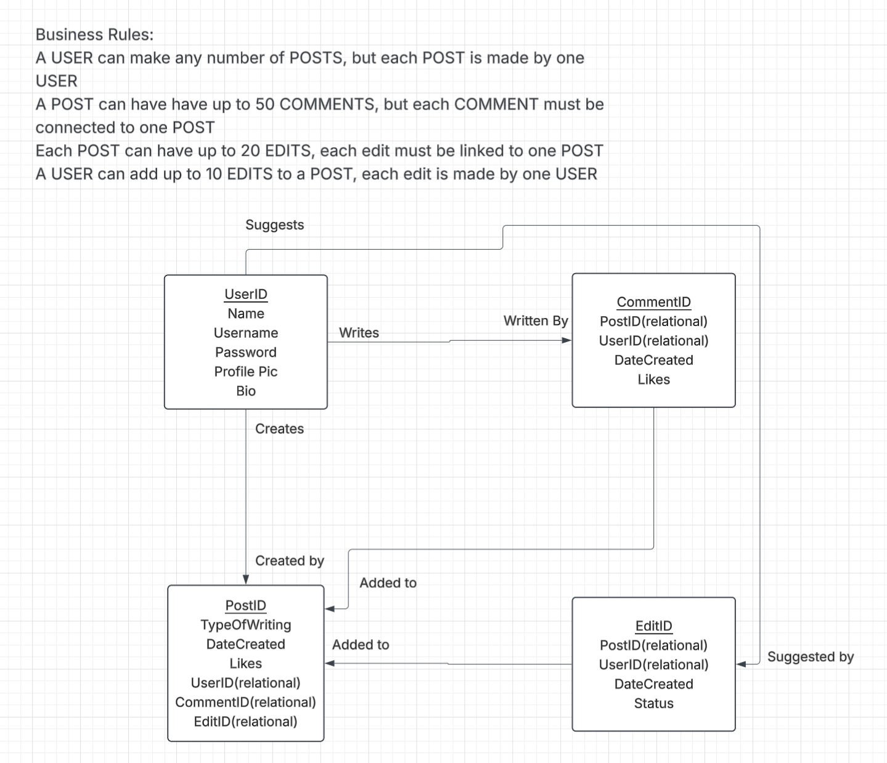
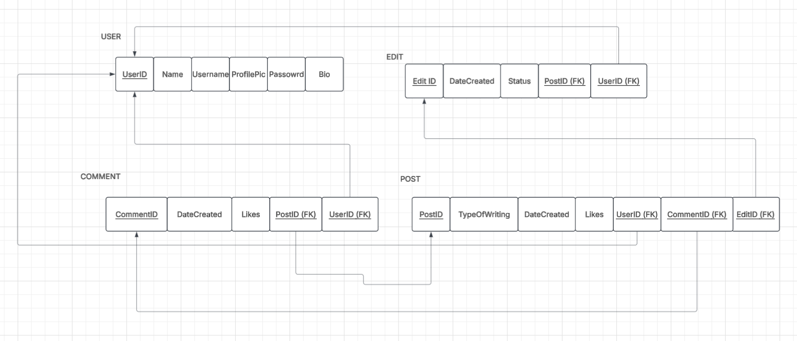
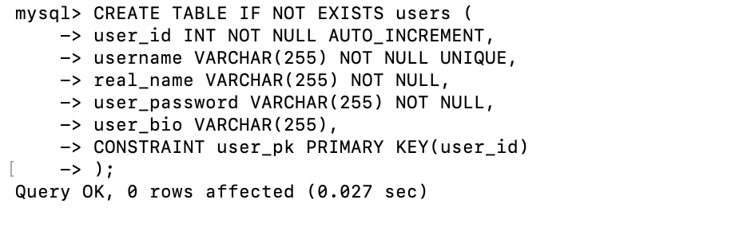
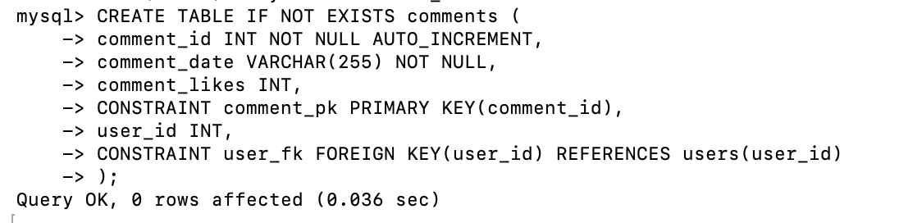
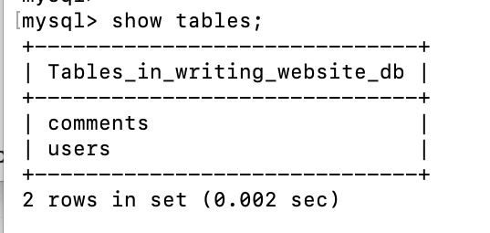

The idea for my project is going be an app where writers can post any writing they are working on and will receive edits and feedback by fellow users. A problem this app solves is being too nervous to ask for help when writing since the users won't know anything about each other, other than their user name. The intended users are college students writing essays or doing creative writing assignments. Actions users will be able to do are sign up, login, post, comment, and like posts.  

Entities:
    User
    Post
    Comment
    Edit

Business Rules:
    A user can make any number of posts, but each post is made by one user
    A post can have have up to 50 comments, but each comment must be connected to one post
     Each post can have up to 20 edits, each edit must be linked to one post
    User can add up to 10 edit to a post, each edit is made by one user

ERD:

Relations

Database Implementation:
    Used MySQL
    Added "users" and "comments" tables
    Comments are made by one user each and contains a user foreign key, users can create comments on any post
    schema.sql file
    
    Users Table Creation:
    
    Comments Table Creation:
    
    Resulting Tables:
    

